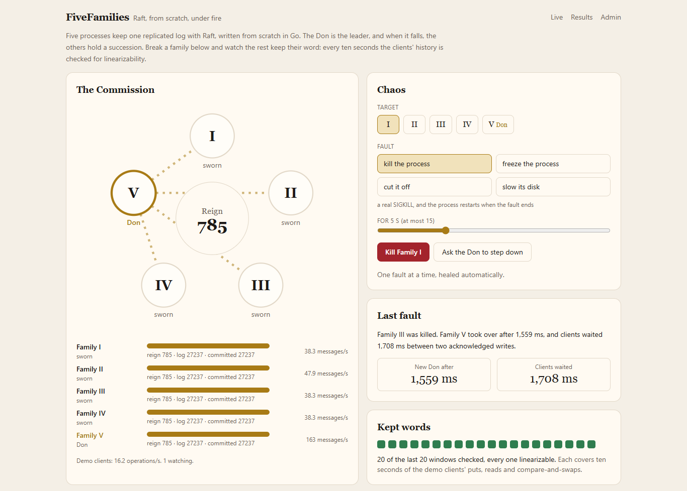

# FiveFamilies

I'd never built distributed consensus, and none of my other projects touch it. Raft itself is a university assignment, and Go already has two excellent implementations (etcd/raft and hashicorp/raft), so having Raft wasn't the point. I wanted the part that's rare: evidence that it stays correct when the network splits, processes crash or freeze and disks lose what wasn't synced, and a number for what each guarantee costs, measured next to etcd on the same machine.

FiveFamilies is Raft written from scratch in Go: leader election with PreVote and CheckQuorum, log replication with batching and pipelining, a write-ahead log with checksums and group commit, snapshots, membership changes with learners, and three ways to read. On top of it there's a key-value store with compare-and-swap, sessions that make retries safe, TTL leases, watches, a service registry and configuration keys. [PortalGun](https://github.com/mirzanajafov/portalgun-router), my API gateway, finds its upstreams through that registry.

The name comes from a scene in The Godfather where the heads of the five families sit at one table and agree to keep the peace. A Raft cluster works the same way: nothing is decided without a majority, one leader speaks for it, and when the leader falls the others hold a succession. So in the dashboard the cluster is the Commission, a node is a family, the leader is the Don and a term is a reign.

It's running at **[fivefamilies.najafov.dev](https://fivefamilies.najafov.dev)**. You can kill the Don, freeze a family, cut one off or slow its disk, and watch the others hold a succession while the demo clients' history is checked for linearizability every ten seconds. Most of the numbers below are on the [results page](https://fivefamilies.najafov.dev/results) too.



One thing up front: all five nodes always run on one machine, my laptop for the measurements and a small shared server for the demo. Crashes and pauses are real (SIGKILL, and SIGSTOP or the cgroup freezer), except in one experiment that says so, and so is fsync. In the lab a partition is real too, packets dropped with iptables. But the network between the nodes is a Docker bridge, so there's no distance to speak of, and clocks can't drift because every container reads the same kernel clock. Clock drift and lost unsynced writes exist only in the simulator. On the public demo a partition is a filter in the node's own transport and a slow disk is a delay in its file layer, because the demo gets no privileges to do it for real.

## How it's built

The decision everything else rests on is that the Raft core is a deterministic state machine, the shape etcd/raft has. It's a plain struct with no goroutines, clock, sockets or files. Messages, ticks and "this write is now durable" go in, and what comes out is a batch of work for the driver: entries and the term and vote to persist, messages to send now, messages to send only once that write is on disk, and entries to apply. Randomness comes in through a seeded generator, and peers live in a sorted slice instead of a map, because one loop over a Go map is enough to break replay. A test parses the package and fails on any import outside a short list (`errors`, `fmt`, `slices`, `strings` and a few more), so no clock, file, socket or global randomness can sneak in, and CI runs the same seeds twice and compares a hash of the whole trace, which catches a stray goroutine or map loop the day it appears.

What that buys: the same seed gives exactly the same run, so every failure the simulator finds replays under a debugger as often as I want, and simulated time is free. What it costs: more code and a less obvious shape than the paper's RPC-style pseudocode, and a contract (persist this, then send that) that tests of the core alone can't see. That's why the code around the core (the driver, applying entries, the WAL's logic) is deterministic too and runs inside the simulator unchanged. Only the thin runtime (goroutines, gRPC, real files) stays outside it, and the real cluster is there to test that part.

The rest, with the decisions I'd defend:

- **Elections** use randomized timeouts, PreVote and CheckQuorum, so a node that was cut off can't depose a healthy leader when it comes back, and a leader stuck on the minority side steps down instead of taking writes that can never commit. A candidate becomes leader only once its own vote is on its own disk, whatever the others say. The simulator taught me that one (below).
- **Storage is asynchronous.** The leader sends its appends before its own write finishes and counts itself toward the quorum only once its fsync is done (section 10.2.1 of Ongaro's thesis). Heartbeats never wait for the disk, which the section on short timeouts below turns into a number. One goroutine owns the WAL and syncs everything that queued up while the last fsync ran, so under load many writes share one flush, with no artificial delay.
- **The WAL** is segments of records with a CRC32C over a per-segment random salt, the type and the payload, so a record left over from an earlier use of the same bytes can't pass. After a crash, the first bad record in the last segment is cut, with everything after it, only if it runs past the end of the file or one of its sectors is all zeros, and a last segment whose header is short or all zeros is dropped. That's what a killed process or a power cut on ext4 or xfs leaves behind. Any other damage (a flipped byte elsewhere in a record, a segment header that's damaged rather than missing) refuses to start, because cutting there could drop entries this node acknowledged, the trap the FAST 2018 paper on protocol-aware recovery describes. My first rule cut any bad record at the end of the log, which keeps a node starting but silently loses a vote when the damage is in data that was already synced. The price of refusing is that a node with real corruption has to be removed and added back empty, and there's no repair tool. What still gets cut, with only a warning in the log, is damage that looks exactly like a lost write: zeros running to a sector boundary or to the end of the file (a damaged last record that happens to end in zero bytes counts), or a length field flipped so that the record runs past the end of the file. Telling those apart needs a checksum over the record header or the other nodes.
- **Snapshots** of the in-memory store are written under a temporary name, fsynced and renamed, then a marker goes into the WAL, and only once that marker is durable do the old segments go. A follower that's too far behind gets the snapshot over its own stream in 1 MiB chunks, so heartbeats never queue behind it.
- **Reads** go one of three ways: through the log (a write per read), ReadIndex (one heartbeat round confirms every read waiting for it), or a leader lease (no messages at all, as long as the clocks drift apart by less than the margin between the lease and the election timeout, 800 ms against 1 s in the compose files). A follower can serve reads too, after asking the leader for a read index. ReadIndex is the default, because a lease depends on an assumption that clients can't see.
- **Membership** changes one server at a time, new nodes join as learners and can be promoted once they're within 1,000 entries of the leader, and a new leader has to commit an entry of its own term before it may change anything (the known fix for single-server changes). I left joint consensus out, since one at a time covers every change the demo makes. Leadership transfer is there too.
- **Client sessions** (section 6.3 of the thesis): every write carries a client ID and a sequence number, and the state machine keeps each client's last answer, so a write that's retried after a timeout applies once. Without them the linearizability checker finds real violations, and they're the client's fault.
- **Leases, watches and the registry.** A TTL lease is decided by the leader's clock and expired through an entry in the log, since the state machine must never read a clock. A new leader gives every lease a full TTL again, so a lease can expire late but never early. Watches start from a revision, are served from any node's applied state, and say "compacted" when the history they need is gone. The registry and the configuration keys are just the client library on top of those two.

## Is it correct?

There are two nets, one that watches what the nodes do and one that only sees what clients saw, and I tried to make each prove that it works.

**The simulator** runs the whole cluster in one goroutine with a simulated network, disk and clock, all driven by a single seed. Each seed turns on a random subset of faults at random intensities (swarm testing, from Groce et al.): message loss, delay, reordering and duplication, partitions of four shapes (one node cut off, a majority and a minority, one-way links, and a node bridging two halves), crashes and restarts, pauses that freeze a node while its messages pile up, slow disks, clocks running at different rates, and crashes aimed at the worst moments, right after a node sends a vote or an acknowledgement (the idea behind FoundationDB's BUGGIFY). Each node's disk is the real WAL code on a simulated file system that knows which bytes are durable, so a crash keeps the synced bytes plus a random prefix of the rest, sometimes with a hole in it. Every run ends with a heal, after which every client operation has to finish and a leader has to commit.

After every step it checks the protocol invariants (Election Safety, Log Matching, Leader Completeness, State Machine Safety, and that a committed entry stays durable on enough disks that every quorum includes one), and at the end the whole client history goes through Porcupine, the linearizability checker etcd's own robustness tests use. A check that runs out of time counts as unknown, never as a pass. On the evening of 2026-10-17 I ran 100,000 seeds on the code as it was then, half of them modelling the server loop's batching, and none failed. Since then, every refactor of code the simulator runs that wasn't meant to change behaviour has had to give identical simulator totals for 1,000 seeds in five configurations before it was merged.

A clean run proves nothing if the net has holes, so I planted bugs on purpose. Each one is a switch that the production image can't turn on, and CI replays a known seed for each of them on every pull request (not always the first one, but one that still catches it). The table gives the first seed that catches each one, searched again on 2026-10-23:

| planted bug | what it breaks | what catches it | first seed that catches it |
|---|---|---|---|
| `figure8` | commits an entry from an earlier term by counting replicas (Figure 8 in the Raft paper) | Leader Completeness | 1,628 |
| `staleterm` | accepts appends from a leader with a lower term | State Machine Safety | 667 |
| `prevterm` | accepts appends without comparing the previous entry's term | State Machine Safety | 10 |
| `anyvote` | grants votes without the up-to-date log check | Leader Completeness | 1 |
| `nofsync` | sends votes and acknowledgements before they're on disk | durability on a quorum | 1 |
| `followerread` | a follower answers reads from its own state | linearizability, and nothing else | 1, with follower reads on |
| `localkeepalive` | a leader renews a lease without checking it still leads | the lease check (an expiry earlier than an acknowledged keepalive allows) | 42 |
| `watchgap` | a watch replays from one revision too late | the watch check | 2 |
| `watchkeep` | installing a snapshot keeps the node's watchers | the watch check | 7 |
| `earlyconf` | a membership change before the leader's first entry of its term commits | Leader Completeness | 7,622, with PreVote off |

The last one is the only one random search couldn't find with the default settings. It needs an even-sized configuration, two leader changes, and a voter that votes for the second leader, misses its entries and then votes for the first. With PreVote on, that last vote is refused in the sequence I know, so 20,000 seeds found nothing. A short hand-built test of Ongaro's sequence, with PreVote off, shows it in a few lines. I don't count PreVote as the fix, since it isn't there for this: what makes a change safe is the rule that a new leader commits an entry of its own term first.

The nets earned their keep on my own code, too:

- **A leader before its own vote was on disk.** In a five-node cluster three other votes are already a quorum, so a candidate could win before its own term and vote reached its disk. In seed 2888, node 4 won term 30, replicated two entries, was killed before its vote was durable, came back in term 29, ran for term 30 again and won again with a shorter log, then wrote different entries at the same indexes under the same term. Election Safety saw nothing, because it was the same node both times. The durability invariant and Log Matching caught it. The fix is one condition, a unit test pins it, and Election Safety now also fails when one node leads the same term twice.
- **A lease measured in ticks doesn't see a pause.** In seed 172 the leader was frozen, the others moved on and wrote, and when it woke up it answered a read from its backlog before its first tick, with a lease that still looked fresh. That's the textbook GC-pause problem with leases. The fix replays the ticks a node missed before it handles anything else. A week later I found the same hole in the real server's loop, which caught up before the first event of each pass but not before the events it drained after it. A test of exactly that answered with the old value in 8 of 8 runs before the fix.
- **Leases that expired one tick early.** 96 of 2,000 seeds failed the never-early check, each by less than a tick (a 225 ms lease gone after 222.97 ms), because the tick a keepalive arrives in is already partly over.
- **Watches that waited forever** on a node that had been removed from the cluster or sat in a minority, getting progress at a revision that never moved. A node without a leader now ends its watches after two election timeouts.

Twice, what the simulator reported was a bug in my own checks, not in Raft: Leader Completeness only speaks about leaders of later terms, and a node outside the quorum may legally overwrite an entry that's committed elsewhere. And random search missed one more real bug that a short test shows. A follower that acknowledged the leader, crashed and came back is free to vote at once, because the promise not to vote lives in memory, so two nodes cut off from the leader plus a restarted one can elect a new leader inside the old leader's lease. That needs a partition, a restart and an election inside about 120 ms, and 4,000 seeds with every read on the lease path never produced it. With lease reads on, a node now refuses to vote for one election timeout after it starts. The price is that a node that has just started can't help elect anyone for that long, so an election that needs its vote waits up to one more election timeout.

Halfway through I stopped adding features and audited the whole codebase. The first round of fixes from it was nine bugs, one of them live in production: cleaning up old snapshots could delete the one the WAL still pointed to, and the next restart would have failed. Each fix came with a regression test that fails without it, except for a few paths that only Docker reaches. Reviewing each later change found more, most of them fixed in the same pull request and three still open (below).

**The real cluster** is five processes in Docker on my laptop and a nemesis that SIGKILLs and restarts nodes, freezes them with the cgroup freezer, cuts links with iptables and adds delay and loss with tc netem. A small sidecar owns each node's network namespace and is never killed, so a partition survives the node behind it restarting, and the node containers run with no capabilities at all. Six clients record a history, and after the heal every node has to reach the same state hash and the history has to be linearizable. Six committed three-minute runs, 187 faults and 287,516 operations between them, five of them with membership changes and leadership transfers in the mix, were all linearizable, with every node at the same state and no write left indeterminate.

The planted bugs mostly don't show up there. In 90 seconds each, the lab caught `anyvote` both times I tried and missed `prevterm`, `staleterm` and `figure8`, which is about what the simulator predicts: it first catches those three at seeds 10, 667 and 1,628, each a run with 20 seconds of faults, and the lab gave each bug two runs of 90 seconds, about nine seeds' worth. The dropped fsync can't be caught in the lab at all: SIGKILL leaves the page cache intact, and I never set up a file system that drops unsynced writes (LazyFS), so that one is proven in simulation only. The simulator is where the protocol gets proven, and the lab is where real sockets, disks and processes get their chance to show something the simulator doesn't model.

## What it costs

Everything here was measured on my laptop (i7-1270P, Docker Desktop on WSL2, a Samsung PM9A1 NVMe reached through ext4 in a virtual disk), in the evening with Chrome and Slack closed and nothing else running but a few idle containers of another project, except for a few diagnostic runs on a busier morning, which I mark where they come up. For the throughput and read curves each node was pinned to its own CPU and the load generator had CPUs of its own, and for failover and the registry each node had a quota of one CPU. The generator is open-loop and measures latency from each request's scheduled time, so a stall can't hide in the tail. The laptop has performance and efficiency cores and Windows decides which one a pinned CPU lands on, so I only compare numbers from the same evening, and the ones that matter ran three times, interleaved.

### Failover

SIGKILL the leader under 200 writes a second, ten kills per row, and take the widest gap between two acknowledged writes on the client's own clock:

| election timeout | clients waited, median | range |
|---|---|---|
| 150 ms | 194 ms | 179-233 ms |
| 300 ms | 378 ms | 352-714 ms |
| 600 ms | 706 ms | 641-814 ms |
| 1 s | 1,206 ms | 1,122-1,449 ms |

Without a fault the widest gap in the same runs was 11-25 ms. The election timeout is nearly the whole story, as long as the client already holds a connection to every node. My first sweep was slower, and the reason was the client: with its write connections cold, the client's own part of the gap was 35-150 ms against 24-29 ms with every connection already open, because it had to connect to the followers only after the leader had died. So the client library now connects to every node when it's created. Production runs with a 1 s timeout, because a node capped at a quarter of a CPU on a shared server can stall for longer than 150 ms. In the lab a 1 s timeout cost about 1.2 s per failover (with a heartbeat of a third of the timeout, where production uses 100 ms), and on the busy demo server the screenshot above caught clients waiting 1.7 s.

### The price of a short timeout

A short timeout buys fast failover and should pay for it in elections nobody wanted. So I injected disk stalls and pauses through the node's own chaos call (a delay in its file layer, and a pause of its event loop rather than the whole process) on a cluster taking 300 writes a second, five of each, and counted the ones followed by an election:

| fault | T = 150 ms | 300 ms | 600 ms | 1 s |
|---|---|---|---|---|
| the leader's disk stalls for 100 ms, 300 ms or 1 s | 0 of 15 | 0 of 15 | 0 of 15 | 0 of 15 |
| a follower's disk stalls for 1 s | 0 of 5 | 0 of 5 | 0 of 5 | 0 of 5 |
| the leader pauses for T/2 or T | 0 of 10 | 0 of 10 | 0 of 10 | 0 of 10 |
| the leader pauses for 2T | 5 of 5 | 5 of 5 | 5 of 5 | 5 of 5 |
| a follower pauses for 2T | 0 of 5 | 0 of 5 | 0 of 5 | 0 of 5 |

A one-second disk stall on the leader at a 150 ms timeout, almost seven timeouts long, caused nothing, because the leader's heartbeats don't wait for its disk, only its writes do. To check that this is what buys it, I ran the same stalls with the event loop waiting for every fsync: at a 300 ms timeout a one-second stall then caused an election every time, the failure etcd's documentation warns about. I predicted that any leader pause longer than T would cause an election, and the boundary turned out to be somewhere between T and 2T, because a follower times out after a random draw from [T, 2T). So on this laptop the disk isn't what limits a short timeout, pauses are.

### Throughput, and the batching I was throwing away

Writes of 128 bytes, open-loop, doubling the rate until a step falls behind and then bisecting. The knee is the highest rate a step kept up with: at least 90% served, under 1% failed, p99 under a second, and my generator on schedule without hitting its limit of 10,000 requests in flight. Over three interleaved rounds the knees were 8,000 writes a second on three nodes (7,000-8,000), 5,000 on five (4,000-6,000) and 6,000 on seven (every time), and three more rounds of the five-node curve in the etcd comparison gave 6,000 (6,000-7,000). Three nodes are ahead and five and seven overlap. The five-node knee moved between 4,000 and 6,000 on identical settings, so I don't read anything into a single run.

The first evening of measurements had a finding I didn't expect: at 4,000 writes a second on five nodes, a write cost 16 messages, about an append and an acknowledgement per follower and the same again to carry the new commit index. The core batches everything that's queued when the driver asks it for work, but my server loop asked after every single event, so under load there was never more than one entry to batch. Taking the whole queue (up to 256 events) before asking halved the messages per write (8.4 against 15.5 at 4,000 a second) and lifted ReadIndex's knee from 8,000 to 14,000 that night (12,000 in all three rounds the next evening), because reads that queue up now share one heartbeat round. The write knee moved by less than the noise.

So I went looking for what sets it. A CPU profile of the leader at 4,000 writes a second had it 54% busy, about half of its samples in socket writes under gRPC, and 6% in the event loop, which holds the Raft core and the store. At 6,000 a second it was less busy, 39%. It wasn't the CPU. An execution trace found it: each node is pinned to one CPU, so Go ran it with one processor (P), and the event loop, the senders it wakes for each peer and gRPC's writers all took turns on it. In a 5-second trace the loop was ready to run but not running for about a second, mostly right after it had handed a message to a peer's sender. With two Ps on the same single CPU, two rounds gave knees of 14,000 and 7,000 instead of 5,000-6,000, with no elections. Those were diagnostic runs on a morning when the laptop wasn't quiet, so I take them as a direction rather than a result. Every node now runs with at least two Ps, and the proper runs are next.

Two theories I measured and dropped on the way, in the same diagnostic runs of 2026-10-19: the snapshot that's written inside the event loop (on and off gave knees one step apart, 6,000 and 5,000), and a preallocated WAL with fdatasync, which is what etcd does. A standalone test on this disk got 434-591 flushes a second out of five writers in every mode it tried, and at the one-P knee on the evening runs the five nodes were doing 503-628, about as many. With two Ps the same disk carried 14,000 writes a second on 443 flushes, because each flush carried more, so the flush rate isn't what sets the knee, and preallocation stayed inside the same range for five writers anyway.

Past the knee, with one P, the cluster didn't slow down, it collapsed. At 10,000 writes a second it served 218. The leader accepted every proposal, latency passed the clients' 2-second timeout, and from then on it worked for writes nobody was waiting for any more. A cap on uncommitted entries (refuse with `ResourceExhausted` past 4,096) didn't save it (267 a second with the cap). A diagnostic run later showed that the writes did commit, at 2,400-2,800 a second, but only after the clients had given up, because the loop was waiting for its one P. With two Ps the steps past the knee kept serving 93-97% of what was offered, and nearly everything the leader turned away it refused at once with `ResourceExhausted` instead of letting it time out (1,400 refusals against 10 timeouts in one of the two steps), which is what the cap was for. My generator hit its own in-flight limit in both of those steps, though, so they don't count as measurements either.

### fsync

| five nodes, writes | knee | p50 at 500/s | entries per fsync near the knee |
|---|---|---|---|
| group commit (the default) | 5,000/s | 12.8 ms | 50 |
| one fsync per write | 110/s | 11.1 ms (at 63/s) | 1 |
| no fsync (unsafe, for reference) | 24,000/s | 0.7 ms | |
| group commit, the leader writes before it sends | 4,000/s | 15.4 ms | 30 |

One fsync per write caps the cluster at 110 writes a second. With five nodes sharing this disk that's a flush every 9 ms or so per node, and one writer alone gets one in 2-6 ms in the 2026-10-19 disk test, against the 0.5-3 ms I guessed for a bare NVMe (this one sits under ext4 in a virtual disk on NTFS). So fsync is the floor of a write's latency, not its ceiling: 0.7 ms without it, 12-13 ms with it, and group commit packs about 50 entries into one flush near the knee. Writing in parallel with replication instead of before it saves about 2.7 ms at the median at low load.

### Reads

At 95% reads on five nodes:

| read path | knee | read p50 at 2,000/s | messages per operation at 2,000/s |
|---|---|---|---|
| lease | 16,000/s or more | 0.3 ms | 0.8 |
| ReadIndex | 12,000/s or more | 0.7 ms | 12.8 |
| follower ReadIndex | 20,000/s or more | 1.0 ms | 14.4 |
| through the log | 6,000/s | 13.4 ms | 9.3 |
| a follower's own state, unsafe | 32,000/s | 0.4 ms | 3.1 |

A lease read costs about what an unsafe read of a follower's own state costs (the planted `followerread` bug, measured only as a reference) and sends no messages of its own (the 0.8 is the writes' share). ReadIndex got to three quarters of the lease's knee before the generator ran out, but at moderate load almost every read still pays for its own heartbeat round, because the loop is faster than the arrivals and there's rarely a second read waiting to share it. Follower reads take the serving off the leader and go highest of the safe paths, but each one still costs the leader a round. Past their knees the read paths didn't collapse the way writes did: they still served 87-98% of what was offered with no errors, but my generator hit its limit of 10,000 requests in flight there, so those knees are lower bounds, the same as etcd's below. That's also why lease and ReadIndex gave the same knee in all three rounds.

ReadIndex stays the default for a reason. A leader lease is only safe while the clocks drift apart by less than its margin. TTL leases rest on the same kind of assumption, and in the simulator a clock running 60% fast makes them expire early in 223 of 1,000 seeds. For lease reads the simulator never produced the stale read in 3,000 seeds with the same skew, because it also needs a particular partition at the right moment, so showing that one is still on my list.

### Next to etcd

etcd 3.6.15 from its official image, with the same pinning, the same generator and the same timeouts (100 ms heartbeat, 1 s election). My client sends writes straight to the leader, while etcd's client was spread over all members and its followers forward to the leader, so I also ran etcd with its client on the leader only:

| | FiveFamilies | etcd 3.6.15 |
|---|---|---|
| writes, 3 nodes: knee | 6,000/s | 24,000/s or more |
| writes, 5 nodes: knee, median of three rounds | 6,000/s | 16,000/s or more |
| write p50 at 500/s, 3 and 5 nodes | 10.9 and 12.6 ms | 22.8 and 36.2 ms |
| writes, 5 nodes, etcd's client on the leader only: knee, p50 at 500/s | 6,000/s, 12.6 ms | 12,000/s, 23.6 ms |
| linearizable reads at 95%: knee | 12,000/s or more | 32,000/s or more |
| reads from local state at 95%: knee | 40,000/s (a follower's own state, unsafe) | 32,000/s or more (serializable) |

The "or more" is my generator as much as etcd. One step past each of those etcd knees etcd's latency was climbing, but it still served 95-100% of what was offered with p99 under a second, while the generator either hit its own limit of 10,000 requests in flight or started requests late, and my rule throws such a step out. FiveFamilies' write curves ended the other way: one step past its five-node write knee it served 5,044 of 7,000 writes a second and 12,548 failed in ten seconds, with p99 at the clients' 2 s timeout. My generator hit its limit there too, but the failures alone rule that step out. Apart from the five-node writes these are single rounds, which is why FiveFamilies shows 6,000 on three nodes here and 8,000 in the throughput section. The unsafe local reads show 40,000 here and 32,000 in the reads section for that reason and one more: the reads section's nodes ran with lease reads on.

So on five nodes etcd takes at least 16,000 writes a second against my 6,000 (12,000 against 6,000 with both clients on the leader), on three at least 24,000 against my 6,000-8,000, and on linearizable reads both stopped where my generator did, etcd at 32,000 and FiveFamilies at 12,000, with latency climbing on both sides. I expected to be close on writes, because FiveFamilies does less per write (the state lives in memory, with no B-tree on disk and no MVCC history), and at low load it is faster, 11-13 ms against etcd's 23-36 ms (23.6 ms on five nodes with its client on the leader). Under load it isn't close. What I can say for sure is that etcd doesn't collapse past its knee, partly because it refuses new proposals once applying falls 5,000 entries behind (the "too many requests" it answered in those steps), and that my leader wasn't CPU-bound at its knee but waiting for its one Go processor. Both systems ran on one pinned CPU per node, so Go gave both one P. I haven't run etcd with two yet, so I can't say how much of the gap two Ps close for me and not for it. Even my unsafe local reads, which skip Raft entirely, don't beat etcd's serializable reads by any margin my generator can show.

## The registry, and PortalGun

An instance registers by putting `/registry/<service>/<instance>` with its address and metadata under a lease and renewing it every third of the TTL, and a consumer lists the prefix and watches from the revision it read. What a consumer cares about is how long a dead instance stays visible. With a 2 s TTL, killing the instance's container with SIGKILL, ten times each:

| what died | gone for the consumer after, median | range |
|---|---|---|
| the instance | 1.75 s | 1.47-2.08 s |
| the instance and the leader | 3.18 s | 3.07-3.37 s |

Alone, the kill lands at a random point between keepalives, so it should take between two thirds of a TTL and a full one, and the worst case went past the TTL only by the time `docker kill` itself took. With the leader, a new leader gives every lease a full TTL again, so it takes an election plus a TTL. So a dead instance stays visible for up to about one TTL, or a TTL and an election if the leader died too, and the HTTP API's default TTL is 10 s.

PortalGun talks to the registry over a small HTTP API that every node serves under `/v1`, so it doesn't need this repo as a Go dependency: register, keep alive, revoke, and a Consul-style blocking query that returns once anything under the service changes after a given index. The same JSON contract file sits in both repos, and both test against it. In PortalGun's own measurements a new upstream got its first proxied request a median of 15 ms after it registered, and no request was lost in 43 runs (443,047 requests), including runs where the registry's leader was killed or every node was stopped for 30 s, because nothing on PortalGun's request path reads the registry. Registrations did get lost, though: in 3 of 20 runs with a dead leader a dimension's lease ran out by its own clock before a keepalive got through, and after the 30 s outage every dimension had to register again. Each one did so by itself, and since the list came back the same, PortalGun wrote no new config. The weak spot is a registration made while the leader is dead: a median of 2.1 s and up to 8.1 s, where the election takes about 1.2 s, because the node's HTTP API keeps trying the dead leader for 2 s at a time. That's the first thing on the list below.

## How the pieces fit

```
browser ──> web (Next.js) ──> controller ──┬──> supervisor ×5 ──> ffnode ×5   kill, pause
                                           └──> ffnode ×5 admin API           status, isolate, slow disk
PortalGun ──> /v1 HTTP API on every node ──> the cluster's own client ──> the leader
```

Each node runs under a small supervisor that starts it as a child process, so the demo can send it a real SIGKILL or SIGSTOP without the Docker socket. The controller is the only thing the web app talks to. It polls every node, keeps the record, runs three demo clients (puts, ReadIndex reads and compare-and-swaps on three keys, 16-21 operations a second while I watched) only while someone has the page open and for a minute after, and owns chaos. Every 10 seconds it holds the clients back, reads each key through the log and starts the next window from those values, so each window's history is checked on its own. A write whose outcome stays unknown marks its window and the next one unchecked rather than risking a false alarm. Visitors get one fault at a time, at most 15 s, healed automatically, with a cooldown and a limit per address, so the cluster can't be left broken. The admin token sits in an httpOnly cookie that the page's scripts can't read, and only the Next server sends it on to the controller.

On the server everything sits behind the shared reverse proxy, and nothing but the web app is reachable from outside. Each node gets a quarter of a CPU and 64 MB and uses 8-11 MiB of it. Ticking every 10 ms cost an idle node 7-21% of a core, so production ticks every 50 ms (the timeouts stay at 1 s and 100 ms) and the controller polls once a second while nobody's watching. A backup container asks for a snapshot every day and keeps 14 days, and `deploy/restore-check.sh` rebuilds a throwaway cluster from the newest one and compares a hash of every key. `deploy/deploy.sh` backs up, fast-forwards, replaces the nodes one at a time and waits for all five to agree on a leader after each one, then the controller, the web app and the backup job. If the nodes or the web app don't come back healthy, it goes back to the previous commit, replacing the controller, the web app and the backup job before the nodes, so a client is never newer than the nodes it talks to.

## Running it

You need Docker to run it, Node 24 with pnpm for the dashboard in dev mode, and Go 1.26 for the simulator, the lab and working on the code.

```bash
docker compose up -d --build            # five nodes on 127.0.0.1:3151-3155, the controller on :3159
ff() {
  docker compose exec controller ffctl -endpoints n1:3161,n2:3161,n3:3161,n4:3161,n5:3161 "$@"
}
ff put greeting hello
ff get greeting
ff status                               # ffctl alone lists the other commands
(cd web && pnpm install && pnpm dev)    # in its own terminal: the dashboard on :3150, token local-dev-admin
```

`ffctl` runs in the controller's container there, because a follower names the leader by the cluster's own address. Run from the host with the published ports, it can't follow that name and goes round the nodes it was given until it finds the leader, so it needs all five in `-endpoints`. The simulator and the lab:

```bash
go run ./cmd/sim -seeds 1000                       # a batch of seeded runs
go run ./cmd/sim -bug figure8 -first -seeds 5000   # the first seed that catches a planted bug
go run ./cmd/sim -bug figure8 -seed 1628 -trace    # that seed again, event by event
go run ./cmd/lab -build -seed 5 -duration 3m       # five nodes in Docker, real faults, a checked history
go run ./cmd/lab failover -build -trials 10        # failover against election timeouts
go run ./cmd/lab registry -build -trials 10        # how long a dead instance stays visible
go run ./cmd/lab bench -build -experiment e1b,e2,e3,e4,e5   # the rest of the numbers, about two hours
```

`lab bench` takes `-repeat 3` for interleaved rounds and `-only` for single curves, which is how the repeated curves above were run. The lab uses the same ports as the dev stack, so stop that first. Results go to `bench/results/`, and the results page is built from those files. Tests are `go test ./...`, with the race detector in a Linux container, `FF_LAB=1 go test ./internal/lab/` for the lab as a test, and `pnpm test` in `web/`. CI runs gofmt, go vet, the race tests, a fixed set of seeds and every canary, golangci-lint, buf, a check that the generated code matches the protos, the web app's type check, ESLint, Prettier, tests and build, and a check that no tracked file holds a comment.

## API at a glance

gRPC, from `proto/fivefamilies/v1`. A write sent to a follower is refused with the leader's address, and the client library retries there with the same sequence number, or goes round its other nodes when it doesn't know that address. I chose that over forwarding, because forwarding hides failover from the measurements and adds a hop.

| service | calls |
|---|---|
| `KV` | `OpenSession`, `Get`, `Range`, `Put`, `Delete`, `CompareAndSwap` (on the value or the mod revision), with reads through ReadIndex, a lease or the log |
| `Lease` | `Grant`, `Revoke`, `KeepAlive`, `TimeToLive` |
| `Watch` | `Watch` on a key or a prefix from a revision, as a stream |
| `Admin` | `Status`, `ChangeMembers`, `TransferLeadership`, `Chaos`, `Backup` |
| `Peer` | `Send` and `InstallSnapshot`, between nodes only |

The HTTP registry API, on every node started with `-http`:

| | |
|---|---|
| `GET /v1/registry/{service}` | the instances, sorted, with the revision they were read at |
| `GET /v1/registry/{service}?index=57&wait=30s` | the same, once the service changed after revision 57 or the wait is over |
| `PUT /v1/registry/{service}/{instance}` | `{addr, meta, ttl}`, answers with the lease |
| `POST /v1/leases/{id}/keepalive`, `DELETE /v1/leases/{id}` | renew or revoke |
| `GET /v1/status` | this node's view: its role, the leader, the term |

## What's where

| | |
|---|---|
| `internal/raft` | the deterministic core: elections, replication, reads, membership |
| `proto/`, `api/`, `scripts/` | the Protobuf API, its generated Go code with the comments stripped, and the script that regenerates it |
| `internal/node` | the driver between the core and the world, the same code in the server and the simulator |
| `internal/wal`, `internal/snap`, `internal/storage`, `internal/vfs` | the write-ahead log, snapshot files, a node's data directory, and the file-system interface with its simulated disk |
| `internal/kv`, `internal/watch` | the state machine with sessions and leases, and the watch hub |
| `internal/server`, `internal/transport`, `cmd/node` | the runtime, built as `ffnode`: the event loop, the disk writer, the gRPC services and the peer streams |
| `internal/sim`, `cmd/sim` | the simulator, its invariants and the planted-bug canaries |
| `internal/check`, `internal/planted` | the Porcupine model and history format, and the planted-bug switches |
| `internal/lab`, `internal/bench`, `internal/rig`, `cmd/lab`, `lab/` | the Docker lab with its network sidecars and nemesis, the experiments, and what the two share |
| `bench/`, `cmd/ffbench`, `cmd/failgen` | the open-loop load generator with its etcd driver, the failover writer, the disk test, and every result |
| `client/`, `internal/route`, `cmd/ffctl`, `internal/httpapi` | the Go client with the registry, the leader router, the CLI, and the HTTP registry API |
| `internal/supervisor`, `internal/controller`, `cmd/supervisor`, `cmd/controller`, `web/` | the demo: the supervisor, the controller with its chaos limits and windowed checks, and the dashboard |
| `internal/backup`, `deploy/` | the backup format, production deploy, backups and the restore check |
| `internal/tools/nocomments` | strips comments from the generated gRPC code and checks that no tracked file holds one |

## What isn't done

- **More than one machine.** Every number here comes from nodes that share one host. Real distance between nodes, and clocks that really drift, are things I've only simulated.
- **Joint consensus**, so membership changes one server at a time. And the other half of what I had in mind, secrets management in the way Vault does it, isn't started.
- **TLS between nodes.** The admin service has no authentication and is reachable from the private networks the nodes sit on, which include PortalGun's containers. They're all mine, and that's the whole defence for now.
- **Repairing a corrupted log.** A node that finds one refuses to start and has to be removed and added back empty.
- **Data bigger than memory.** The state lives in memory and in snapshots, which is fine for a registry and configuration, whose data is small.
- **Three bugs I know about.** The client stays with a leader that stopped answering for a whole 2 s attempt, and a keepalive whose window ends first never moves on at all (the 2.1 s registrations above, and a test that has failed twice in CI), a restore that's killed halfway starts the node empty on the next start, and a node stopped while the others run waits for Docker to kill it.

## What I'd do next

- Fix how the client leaves a leader that stopped answering, which should bring a registration during a failover down to about the election.
- The measurements with two Go processors on a quiet evening: three rounds of the main curves, the overload with the caps, and etcd with two processors as well, so the comparison stays fair.
- Recovery numbers: restart time against log length, how long InstallSnapshot takes, and how fast a learner catches up.
- Fewer flushes in the peer transport, since that's where the leader's CPU goes.
- mTLS between nodes, with the admin service on a listener of its own.
- Later: joint consensus, checkpointing lease TTLs across elections, shrinking a failing fault schedule automatically, and running Jepsen against it as an outside check.
